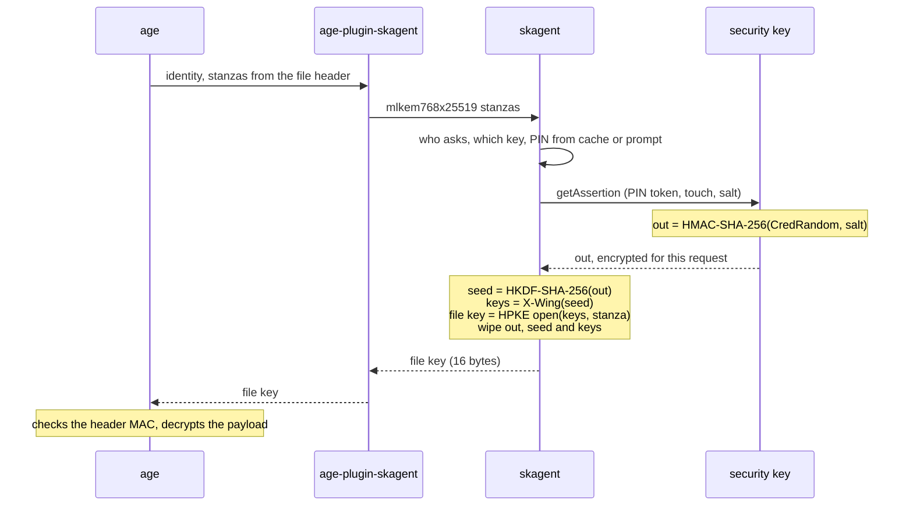

# age: plan

Milestone 12. skagent decrypts [age](https://age-encryption.org) files with a
key derived from a FIDO2 security key. Encrypting needs neither skagent nor the
security key: files go to an ordinary post-quantum recipient (`age1pq1…`) with
stock age. Decrypting takes the PIN, cached as for SSH, and one touch per file,
or one touch for all the files one command decrypts.

Findings this is based on: [`research/hmac-secret.md`](research/hmac-secret.md)
and [`research/age.md`](research/age.md). Steps 1 to 3 below are done:
identities can be created and files decrypted, one touch each. Batches,
forwarding and the home-manager module are still plan.

## what it is for

A repository of age secrets (agenix, agenix-rekey) whose master key lives on a
security key:

- Teammates and CI encrypt without hardware and without a plugin.
- Reading or editing one secret is one touch, and the PIN if it isn't cached.
- Rekeying a few hundred secrets is one touch: `skagent batch -- agenix rekey`.
- Ciphertext that sits in a public repository stays safe against a later
  quantum computer, as far as its other recipients are post-quantum too.

With agenix-rekey that looks like this:

```nix
age.rekey = {
  masterIdentities = [ ./skagent-identity.pub ]; # from `skagent age identity`
  extraEncryptionPubkeys = [ "age1pq1…" ]; # a backup key from `age-keygen -pq`
  agePlugins = [ pkgs.age skagent ]; # age-plugin-pq for rage, age-plugin-skagent
};
```

Read against agenix-rekey's source (commit `87e5d5f`, `nix/lib.nix`), which
runs rage or age with the plugins' directories appended to `PATH`:

- **Decrypting** (`rekey`, `edit`): `-d -i` with every master identity file.
  The file from `skagent age identity` is one. `agenix rekey` runs these as
  children of the `nix run` that the `agenix` wrapper starts, so
  `skagent batch -- agenix rekey` has them all for members.
- **Encrypting to the master identities** (`edit`, `generate`): an identity
  file that is neither age-plugin-yubikey's nor age-plugin-fido2-hmac's is
  passed with `-e -i`, which is why the plugin implements `recipient-v1`.
  Every `extraEncryptionPubkeys` has to be post-quantum too, or age and rage
  refuse the mix.
- **Encrypting for a host:** `-e -r hostPubkey`, to that one recipient. So
  hosts can keep their SSH host keys for now; their copies are post-quantum
  once `hostPubkey` is an `age1pq1…` key.

`vm-age` runs these calls with rage and with age: `-e -i` next to an
`age1pq1…` key, and `-d -i`. agenix-rekey itself wasn't run here: that takes
a repository of secrets encrypted to a key on a security key.

## decisions

Agreed before any code.

- **age's own post-quantum recipient, no file format of ours.** Files carry
  the native `mlkem768x25519` stanza (X-Wing: ML-KEM-768 and X25519, through
  HPKE). The recipient is a plain `age1pq1…`. Ours are the identity
  (`AGE-PLUGIN-SKAGENT-1…`), the derivation of the key and the agent's
  protocol. A stanza type of our own would add a tag that tells before the
  touch whether a file is for this key, and nothing else: age never picks a
  plugin by stanza type.
- **Post-quantum only.** No classic recipient from the same key. age refuses
  to encrypt one file to post-quantum and classic recipients, so a file's
  other recipients need `age1pq1…` keys too.
- **No other formats.** Files encrypted for age-plugin-yubikey or
  age-plugin-fido2-hmac aren't read. Moving over is decrypting with the old
  plugin once and encrypting to the new recipient.
- **The private key is derived at decryption time, in the agent.** FIDO2 has
  no decryption, and no security key does ML-KEM. The agent decapsulates and
  hands out the file key, nothing else. The plugin never holds a secret: the
  only cryptography it does is encrypting to an identity's public key.
- **An identity carries its public key.** So `-i` works for encrypting too,
  without the agent and without the security key.
- **One touch, one file key.** Outside a batch, a request gets at most one
  file key, whatever it sends.
- **A batch keeps the seed.** The security key wants a touch for every
  derivation, so "one touch for many files" means holding the 32-byte seed in
  memory for the batch. Only descendants of `skagent batch` are served from
  it, for at most 10 minutes.
- **Forwarding is opt-in and never batched.** Local requests have a socket of
  their own; everything that arrives on the ssh-agent socket counts as
  forwarded.
- **ML-KEM from `libcrux-ml-kem`**, which is formally verified; OpenSSH's
  ML-KEM is extracted from the same project. The X-Wing combiner and HPKE's
  receiving side are small and written here, against age's test vectors.
- **A second, never-batched identity is reserved, not built.** The salt of the
  first is named for its policy, so the second can be added without changing
  the first recipient.
- **Sealing secrets between uses** (TPM, Secure Enclave) comes later, as a
  backend of `skagent-secret`.

## the key

### credential

One credential per identity, on the security key:

- relying party `skagent:age`. It is no web origin, so no browser can use the
  credential, and OpenSSH's tools leave it alone.
- discoverable, so `skagent load` finds it on any machine;
- credProtect 3: without the PIN the key denies that it exists;
- `hmac-secret`;
- Ed25519. Its signing key isn't used;
- a random 16-byte user id. Creating a credential therefore never replaces
  one, which would destroy its key for good.

skagent creates one only on `skagent age new`, never as a side effect, and has
no command to delete one (`ykman fido credentials delete` does it). Deleting
it, resetting the FIDO application or blocking the PIN loses every file that
has no other recipient.

### derivation

1. `salt = SHA-256("skagent/age/v1/batch")`. Reserved for the never-batched
   identity: `"skagent/age/v1/strict"`.
2. `getAssertion` for `skagent:age` with the credential id, a PIN token,
   `up=true` and hmac-secret with `salt`. The key computes
   `out = HMAC-SHA-256(CredRandom, salt)` and returns it encrypted for this
   request. Never `up=false`: the key refuses that, and it should.
3. `seed = HKDF-SHA-256(ikm = out, salt = "", info = "skagent/age/v1/mlkem768x25519")`,
   32 bytes. The key's raw answer is never used as a key itself, and a later
   scheme can take another `info`.
4. `seed` is an X-Wing private key, the bytes an `AGE-SECRET-KEY-PQ-1…`
   identity holds. `SHAKE256(seed, 96)` gives the ML-KEM-768 key generation
   seed (64 bytes) and the X25519 scalar (32 bytes).
5. The recipient is the ML-KEM-768 encapsulation key followed by the X25519
   public key, as Bech32 with the prefix `age1pq`.

### decrypting



The agent treats the request like a signature: state lock and ticket first,
then routing to the device that holds the credential, PIN, touch. After the
device answered it checks the ticket again, so an eviction in between discards
the result. It tries the stanzas in order and stops at the first that opens:
all stanzas of one file wrap the same file key, so stanzas of several files in
one request still yield one key.

### why it holds

| link | holds because | breaks when |
|---|---|---|
| root secret | generated on the security key, per credential, not exportable | the key's hardware is attacked |
| getting `out` | needs the key, the PIN (credProtect 3) and a touch (the key enforces it) | the PIN is stolen and one touch hijacked: once is enough, for good |
| no web access | `skagent:age` is no web origin; browsers hash their salts and can't send ours | nothing known |
| USB transport | salt and `out` are encrypted with a key agreed per request | traffic is recorded and P-256 falls to a quantum computer |
| in the agent | locked, wiped, non-dumpable process; milliseconds per file | root or the kernel reads memory at that moment |
| recipient | X-Wing holds while X25519 or ML-KEM-768 does | both fall |
| what leaves the agent | only a file key, at most one per touch | a requester gets a touch it shouldn't: one file |

### what it doesn't give

- **A key that stays on the hardware.** The private key exists in the agent's
  memory at every decryption. A signature never exposes the SSH key that way.
- **Revocation.** A leaked seed opens every file, past and future. Old
  ciphertext in a repository's history stays readable with it.
- **A backup.** The credential can't be copied. Every file needs a second
  recipient: another security key's identity, or an offline `age1pq1…` key.
- **More than 128 bits.** age's file key is the ceiling.
- **Protection of what is already published.** Files pushed with classic
  recipients stay as they are.

## identities

- **State:** `$XDG_STATE_HOME/skagent/age.toml` (private, atomic, like the
  other state files): per identity its credential's id and its recipient once
  known. Nothing secret: with the id alone the security key still denies that
  the credential exists. An unreadable file is ignored and rebuilt.
- **Found by `skagent load`:** the credential management listing that finds
  SSH keys also lists `skagent:age`, with the same PIN and no touch. PIN cache
  and binding are primed as for SSH keys. The recipient is known after the
  first derivation on this machine.
- **Routed like an SSH key's credential:** one binding (plug-in, serial,
  pairing), one PIN cache entry per credential and device, the same locks,
  retry guards, pairing challenge before a typed PIN, and waiting for a
  plug-in. Nothing new here.
- **Created by `skagent age new`,** inside the agent like a load: pick the
  device, PIN (asked for afresh, like a load's), a touch to create, a touch
  to derive. It prints the recipient. It refuses if the key holds an identity
  already (looking takes the PIN and no touch), unless `--another` asks for
  one more.
- **Identity strings:** `AGE-PLUGIN-SKAGENT-1…`. Without data it means "the
  identity on the security key at hand", which is what `age -d -j skagent`
  sends. With data (a version byte and the recipient's 1216 bytes) it names
  one, and is all that encrypting to it needs. After a derivation the agent
  compares the public key it derived with the one named, before it tries a
  stanza. A request that names none gets the only identity, or the only one
  whose security key is plugged in; with several at hand it fails and says
  so, without a touch. An identity whose recipient isn't known yet could be
  the one a request names: the derivation tells, and is remembered.
- **Several identities nobody used here yet** (a key with two of them on a
  new machine, after `skagent load`): only the key's answers tell which one
  a request names. The agent tries them in turn, those at hand first, a
  touch each, in the same popup ("Touch once more"). Each is known from then
  on, so this happens once per machine. A request that names none isn't
  tried this way: which identity a file is for would cost those touches
  every time.
- **`skagent age identity`** prints an identity file: the string, and the
  recipient in a `# Recipient:` comment for people and for tools that read it.
  `skagent age list` prints the known identities.

## the plugin

`age-plugin-skagent`, started by age or rage for one file:

- `identity-v1` for decrypting. `recipient-v1` for encrypting to an identity
  (`age -e -i`), which is X-Wing encapsulation to the public key inside it and
  produces the native stanza. It reports the label `postquantum`, so the
  clients keep it apart from classic recipients like a native `age1pq1…`.
  There is no recipient type of ours: `-r` takes the `age1pq1…`.
- It keeps `mlkem768x25519` stanzas, ignores other types and rejects malformed
  ones the way the age specification asks: two arguments, an `enc` that is the
  canonical base64 of 1120 bytes, a body of exactly 32 bytes.
- It finds the agent at `$SKAGENT_AGE_SOCKET`, else
  `$XDG_RUNTIME_DIR/skagent-age.sock`, else `$SSH_AUTH_SOCK`. The last is the
  forwarded case, on a remote host.
- If the agent takes more than a moment, it sends age a `msg`, once, so
  someone at a terminal sees why age hangs. PIN and touch are asked for by
  the agent. A cached PIN with the touch at hand, and later a batch, say
  nothing.
- It reports why a request failed, from the agent's reason code: cancelled,
  timed out, agent locked, no identity, another identity, several
  identities, not allowed on this connection.
- When the age client goes away (its end of standard input closes), it stops
  waiting, which the agent takes as a cancel.
- It switches core dumps off but stays dumpable: the agent recognizes it by
  `/proc/<pid>/exe`, which the kernel hides otherwise. `skagent age` does the
  same. The file key it passes on is in the age client's memory just the same.
- A binary of its own, built from the same Cargo package as the agent and so
  always installed next to it. It doesn't link libfido2, and a check keeps it
  that way.

## agent protocol

Extension messages of the ssh-agent protocol, so forwarding carries them:

| extension | does | where |
|---|---|---|
| `age-unwrap@skagent` | identity and the stanzas of one file in, the file key or a reason out | local socket; ssh-agent socket with `--age-forwarding` |
| `age-batch@skagent` | starts a batch that lasts as long as the connection | local socket, from `skagent batch` |
| `age-new@skagent` | creates an identity | local socket |
| `age-list@skagent` | lists identities and recipients | local socket |

- Decoded strictly, like `session-bind`: a version, exact lengths, nothing
  trailing, 1 to 64 stanzas (`skagent_age::wire`).
- `age-unwrap` answers with the file key, "no stanza is for this identity",
  or a reason code. Codes, not text: through a forwarded agent, what the
  agent knows about this machine stays on it.
- `skagent load` notes the security key's age identities too, and its reply
  counts them next to the SSH keys.
- A locked agent (`ssh-add -x`) refuses all of them.
- Every decryption is logged like a signature: which identity, who asked,
  batch or not. Never key material.
- A PIN that a derivation accepted is a verified PIN and cached under the
  rules of `design.md`.

## sockets and forwarding

- **A second socket,** `$XDG_RUNTIME_DIR/skagent-age.sock` (`0600`, peer uid
  checked, bound like the first). By default it is named after the ssh-agent
  socket (`name.sock` gives `name-age.sock`); `--age-socket` and
  `SKAGENT_AGE_SOCKET` say otherwise. systemd passes both, the one for age
  requests with `FileDescriptorName=age`.
- **It answers nothing of the ssh-agent protocol,** and the ssh-agent socket
  answers no age request.
- **Local means proven local.** On it, the peer's executable has to be one of
  skagent's own: the plugin next to the agent's binary for decryptions, the
  agent's binary for `skagent batch` and `skagent age`. Any `session-bind`
  ends the connection. So a socket forwarded by hand (`ssh -R`) doesn't pass
  for local. After an update the old agent refuses the new plugin until it
  restarts, and says so.
- **Everything on the ssh-agent socket counts as forwarded,** with or without
  a session bind. Clients that forward without binding (their own SSH
  implementations) then show up as an unverified host, not as local.
- **Off by default.** Without `--age-forwarding` the ssh-agent socket doesn't
  know the extensions.
- **A forwarded request** always asks for the touch, is never served from a
  batch (also not one whose own command asks through the ssh-agent socket),
  and can't create or list identities or open a batch.
- **Who asks** is the host the agent was forwarded to last, by the host key
  that signed its session bind; if that isn't the first hop, the first one is
  named with it, because only that one is a host this machine's ssh connected
  to. Without a bind, with a failed one, or on a connection bound to
  authenticate: an unverified host. The PIN prompt, the touch notification
  and the log say it: "decrypt a file for the host with key SHA256:…
  (through your forwarded agent)". The popup has one line for it, also on
  its touch screen: "Decrypt a file · for SHA256:+DiY3wvv…", and with
  several hops the first one alone, "· via SHA256:…".
- **What the user can't see:** which file. A stanza says nothing about its
  content, so a host can ask for any file it has a copy of. One touch, one
  file.

## batches

`skagent batch [--for 5m] -- command…`

1. The command line tool connects to the local socket and sends
   `age-batch@skagent`. The agent keeps a pidfd of that peer (`SO_PEERPIDFD`,
   Linux 6.5; without it there are no batches) and checks that it runs the
   agent's executable.
2. The tool marks itself as child subreaper, so orphaned descendants are
   re-parented to it and not to the service manager. It runs the command as a
   child, with the terminal, waits, and exits like the command. It sets no
   limits and isn't hardened, because the command would inherit that; it
   holds nothing secret.
3. The first decryption a member asks for is an ordinary one: PIN, touch. The
   prompt says that it starts a batch, for which command and for how long
   (what is left of the batch's time). The seed stays, in `memfd_secret`
   memory where the kernel has it, else in locked memory.
4. Further requests of members need no PIN and no touch: expand the seed,
   decapsulate, wipe the expanded keys. Members that ask while another one
   is at the security key wait for it, and find its seed. A notification
   counts (see prompts).
5. The batch ends, and its seed is wiped, when
   - the tool exits (its connection closes),
   - the time is up (`--batch-lifetime`, default 10 minutes, `0` for no
     batches; a batch can ask for less with `--for`),
   - the security key is unplugged (checked before every file, and by the
     sweep),
   - anything evicts PINs: lock, sleep, logind outage, `skagent forget`,
     `ssh-add -D`, `ssh-add -x`,
   - the user presses Stop in the batch's notification.

   It ends for good: the command's further files take a touch each, and the
   PIN where it was evicted. A new `skagent batch` starts a new one.
6. Nothing is kept while PINs can't be cached (no logind to watch lock and
   sleep): a batch's requests are ordinary ones then, and say so.

**Who is a member:** a request on the local socket whose peer runs skagent's
plugin and descends from the batch's tool, the innermost one if batches are
nested. The agent walks from the peer's pid up its parents and pins every
process on the way with a pidfd: it reads the parent's pid, takes a pidfd of
it, and reads the parent's pid again; at the end the peer, every parent and
the tool have to exist still. Then no pid changed hands while it looked
(`ancestry.rs`). Whatever it can't prove is not a member and gets an ordinary
request with a touch. A process can't choose its parent, so another program
of the user can't join from outside.

**What it doesn't stop:** malware running as the user can't join, but it can
get inside: change a script the batch runs, or (with yama's `ptrace_scope` at
0) attach to a member. It can also start a batch of its own: the prompt then
names its command, and the user's touch is what decides. That is the limit
the threat model already has.

## prompts

- **Text:** the PIN prompt, the touch notification and the log say "decrypt a
  file", the identity, and who asks: for a local request the program that
  started age (from the peer's parents, shown through `display::shown`; a
  wrapper around age like agenix-rekey's `ageWrapper` is passed over), for a
  forwarded one the host.
- **Popup:** the request kinds `decrypt` (with who asks), `batch` (with the
  command and the time) and `create`, shown in the states of a signature:
  "Decrypt a file · agenix", "Decrypted", "Decrypt files for 10 min · agenix
  rekey", "Batch started", "Create an age identity", "Created". A batch is
  named with the PIN and with every touch, also where the touch screen would
  show the YubiKey's name: after a cached PIN the touch is all the user
  agrees with. A failure is worded for what was asked ("Couldn't decrypt",
  "Couldn't create it"): the `failed` state carries the request. "Decrypted"
  is only said once a file key came out: the popup stays on the touch until
  the agent unwrapped, and a file that isn't for the identity ends in
  "The file isn't encrypted to this identity". All of it needs a look from
  the popup's design; `nix build .#screenshots` draws every state.
- **A running batch** is shown by a desktop notification, not by the popup:
  the popup is an overlay that takes the keyboard, and a batch runs for
  minutes. The notification appears once the batch keeps a seed, names the
  command, counts the files in place and says how long the batch lasts at
  most. Its button stops the batch. If the batch ends before its command is
  done, the notification says why; else it goes with the batch. With any
  prompt, also with `--no-touch-notification`. Without a notification
  service, `skagent forget` stops a batch.
- **A pressed button is the end of its notification.** A notification
  service closes a notification whose button was pressed, and says both:
  `ActionInvoked`, and `NotificationClosed` right after it (some may say it
  the other way around). The agent reads the service's signals from one
  stream, in the order they were sent, and takes a press also for a
  notification the service just called closed: a Stop that is taken for
  "the user closed it" leaves a batch running that its user stopped. What
  says "Ended: stopped by the user" afterwards is a new notification.
- **Labels:** an identity is shown as "age identity" and its recipient cut
  short. Names of the user's own, like SSH keys have, are open.
- **Stock pinentry and askpass** work with the texts alone: "decrypt the
  files "agenix rekey" asks for, without another touch, for up to 10 minutes
  (a batch)".

## secret memory

- `out`, the seed and a batch's seed are `SecretBuffer`s. The backend is a
  choice per buffer (`from_slice_in`, `strongest_backend`), so a batch's seed
  uses `memfd_secret` where the kernel has it while PINs stay in locked
  memory. It is dropped before sleep, so hibernation isn't blocked.
- A batch's seed is read where it lies, under the lock that also guards the
  PIN cache: an eviction comes either before a file key or after it, never
  in between, and no copy of the seed leaves the batch.
- Not covered, and short-lived: libfido2's copy of `out` (wiped when the
  assertion is freed), what `libcrux-ml-kem` and the X25519 code keep on the
  stack and heap while they run, and the file key in the reply buffers of
  `ssh-agent-lib`.

## the test key

soft-fido2 answers hmac-secret without a touch and without listing the
extension. So `skagent-testkey` lists `hmac-secret` and refuses a
`getAssertion` with the extension and `up=false`, in front of soft-fido2 like
its other touch decisions. Done: `checks.vm-testkey` runs the hardware check
against it.

## steps

Each step ends with `nix flake check` green. For every safety property below:
break it, watch the test fail, restore.

1. ~~**Test key and fido layer.**~~ Done. The test key as above, with
   libfido2's tools as the baseline in `vm-testkey`. `skagent-fido` creates
   the credential, lists `skagent:age` credentials and derives into a
   `SecretBuffer` (`src/age.rs`); tried against the virtual key, and used for
   real from step 3 on.
2. ~~**`skagent-age`.**~~ Done. A crate without I/O and without `unsafe`:
   stanzas, recipient and identity strings, the derivation of the seed, X-Wing
   expansion, decapsulation and encapsulation, both sides of HPKE's base mode.
   Tested with age's `hybrid*` vectors, the X-Wing draft's vectors, the
   specification's example, and a recipient and a file that stock age made for
   a seed derived outside this crate (`tests/data/README.md`). In the license
   boundary's shipped crates. What stock age does with a stanza of ours is
   checked in step 3, where the plugin can be run.
3. ~~**One file at a time.**~~ Done. The second socket, `age.toml`,
   `age-unwrap`, `skagent age new|list|identity`, the plugin
   (`skagent-age-plugin`, the binary in the `skagent` package), the texts. The
   way to the security key is the signer's, which now takes a job
   (`Signer::run`): signing is one, deriving an identity's secret the other.
   `vm-age` covers: creating (PIN, two touches) and a second identity only on
   request; files from stock age and from rage with `age-plugin-pq`,
   decrypted through the plugin by both; a file encrypted with `-e -i`, next
   to a native recipient and refused next to a classic one; one touch per
   file and the cached PIN; no touch, no file key; a file for another key; an
   identity file naming another key's recipient; stanzas of two files
   yielding one key; forgetting PINs during the touch; a client that goes
   away; a locked agent; each socket answering only its own requests; a copy
   of the plugin refused; `skagent load` on a fresh machine; two identities.
   The Rust tests cover the messages, the plugin protocol against scripted
   clients and agents, which identity a request gets, and who is answered
   what on the socket.
4. ~~**Batches.**~~ Done. The backend per buffer
   (`SecretBuffer::from_slice_in`), the proof of ancestry (`ancestry.rs`),
   batches as a state machine over explicit time and processes (`batch.rs`),
   kept by the signer next to the PINs so every eviction ends them under the
   same lock, `skagent batch` (`batch_tool.rs`), the notification with its
   count and Stop. `vm-batch` covers: five files for one PIN and one touch,
   and the prompt; the seed's `memfd_secret` mapping coming and going; a
   program outside the batch gets a touch; an orphaned process stays a
   member; three decryptions at once take one touch; after the command, the
   time limit, a lock, `skagent forget`, Stop and an unplug (noticed by the
   sweep, and by a request) the command's further files take a touch each;
   without logind nothing is kept; the popup's states. The Rust tests cover
   the proof against a process table in which pids change hands at every
   step, the state machine, and who gets a batch on the socket. `ssh -A`
   inside a batch comes with step 5, where forwarded requests exist.
5. ~~**Forwarding.**~~ Done. `--age-forwarding`. `vm-age-forwarding`, with a
   client, a jump host and a target: refused by default; with it, the prompt
   names the jump host, every file takes a touch, a host two hops away is
   named with the first hop, a client without a session bind is unverified, a
   forwarded request inside a running batch takes its own touch, and
   `skagent age` and `skagent batch` are refused through the forwarded agent.
6. ~~**home-manager and docs.**~~ Done, but for one thing. The module's
   `age.enable`, `age.batchLifetime` and `age.forwarding`; README,
   `design.md` and `AGENTS.md`. The agenix-rekey setup is read against its
   source and its calls are run in `vm-age` (see the top); running
   agenix-rekey itself on a repository of secrets with a real security key
   is still to do.

## checking with a real key

The VM tests use a virtual key. What only hardware shows is in a guided
check:

```sh
nix run .#age-check
```

It runs an agent of its own on temporary sockets and state (yours isn't
asked anything), creates one identity on the plugged-in key (a mistyped PIN
is asked for once more), and goes
through: creating (PIN, two touches), one file per touch, no touch and no
file (which measures how long the key waits), a batch of 40 files for one
touch, a program outside a batch, Stop in the notification, unplugging,
locking the screen, a request through the ssh-agent socket, and a fresh
agent that finds the identity with `skagent load`. It checks what it can
from results and from the agent's log, asks about what only a person sees
(touches, the prompts' words, the notification), and offers to delete the
identity at the end. Its last block of lines is the report.

What to look out for, beyond its own verdicts:

- **Touches:** two for creating, one per file, one for a whole batch.
- **Words:** the prompt that starts a batch names it and its command, with
  the PIN and with the touch; the one through the ssh-agent socket names an
  unknown host.
- **The notification:** whether your notification program shows the Stop
  button, counts in place or stacks new bubbles, and goes away with the
  batch.
- **Replugging:** whether the key is recognized again without a touch of its
  own, and that the PIN is asked for.
- **The lock:** whether locking your screen reaches the agent at all (it
  listens to logind).
- **Times:** how long the key waits for a touch (the popup's ring assumes
  28 s, what a YubiKey 5.8 took), and how long 40 files take.
- **The PIN retry counter:** it must not be lower afterwards. It can be
  higher: a right PIN sets it back to where it starts, so a key that came
  with a try missing (a mistyped PIN before) leaves with all of them.

What it showed on a YubiKey 5.8 is in
[`research/hmac-secret.md`](research/hmac-secret.md).

## later

- **Sealing between uses.** A third backend in `skagent-secret` that keeps a
  secret encrypted under a hardware key and opens it only while it is used: a
  TPM key that doesn't survive a reboot on Linux, a Secure Enclave key on
  macOS. It protects a memory image, not a running system whose root can ask
  the hardware too. It would cover cached PINs as well.
- **The never-batched identity.**
- **`hmac-secret-mc`,** which saves the second touch of `skagent age new` on
  keys that have it (a YubiKey 5.8 does, one from before 5.7 doesn't).
- **macOS,** with [`macos.md`](macos.md): no `memfd_secret`, and peer and
  ancestry come from other interfaces.
- **Not planned:** forwarded batches (a remote host's processes can't be told
  apart), other plugins' formats, classic recipients.

## open questions

1. **`libcrux-ml-kem`.** Key generation straight from the 64-byte seed,
   wiping of its key types, and its MSRV against the workspace's.
2. **Popup.** The design of the decrypt and batch screens, and whether a
   running batch should have a place of its own on screen instead of a
   notification.
