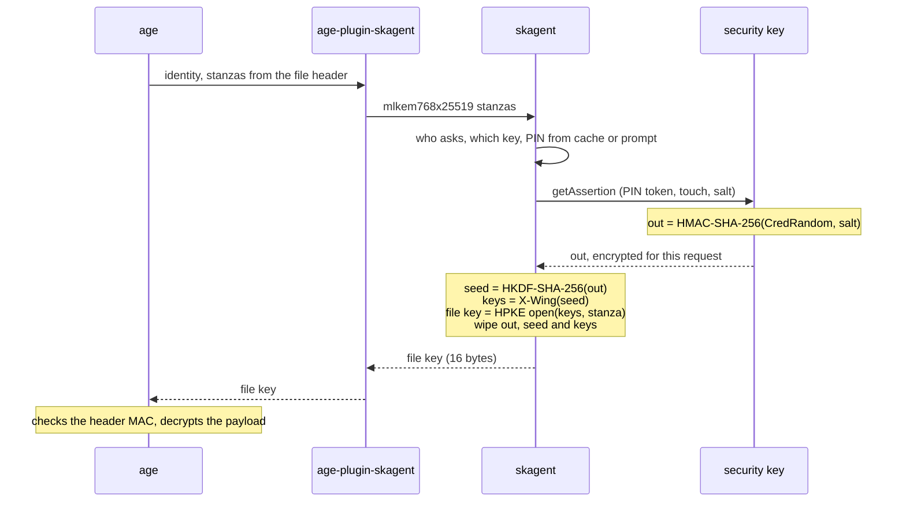

# age: plan

Milestone 12. skagent decrypts [age](https://age-encryption.org) files with a
key derived from a FIDO2 security key. Encrypting needs neither skagent nor the
security key: files go to an ordinary post-quantum recipient (`age1pq1…`) with
stock age. Decrypting takes the PIN, cached as for SSH, and one touch per file,
or one touch for all the files one command decrypts.

Findings this is based on: [`research/hmac-secret.md`](research/hmac-secret.md)
and [`research/age.md`](research/age.md). Nothing here is implemented yet.

## what it is for

A repository of age secrets (agenix, agenix-rekey) whose master key lives on a
security key:

- Teammates and CI encrypt without hardware and without a plugin.
- Reading or editing one secret is one touch, and the PIN if it isn't cached.
- Rekeying a few hundred secrets is one touch: `skagent batch -- agenix rekey`.
- Ciphertext that sits in a public repository stays safe against a later
  quantum computer, as far as its other recipients are post-quantum too.

With agenix-rekey that would look like this (a sketch, checked in step 6):

```nix
age.rekey = {
  masterIdentities = [ ./skagent-identity.pub ]; # from `skagent age identity`
  extraEncryptionPubkeys = [ "age1pq1…" ]; # a backup key from `age-keygen -pq`
  agePlugins = [ pkgs.age skagent ]; # age-plugin-pq for rage, age-plugin-skagent
};
```

The hosts are outside skagent's reach: their rekeyed copies are post-quantum
once `hostPubkey` is an `age1pq1…` key instead of the SSH host key.

## decisions

Agreed before any code.

- **age's own post-quantum recipient, no file format of ours.** Files carry
  the native `mlkem768x25519` stanza (X-Wing: ML-KEM-768 and X25519, through
  HPKE). The recipient is a plain `age1pq1…`. Ours are the identity
  (`AGE-PLUGIN-SKAGENT-1…`), the derivation of the key and the agent's
  protocol. A stanza type of our own would add a tag that tells before the
  touch whether a file is for this key, and nothing else: age never picks a
  plugin by stanza type.
- **Post-quantum only.** No classic recipient from the same key. age refuses
  to encrypt one file to post-quantum and classic recipients, so a file's
  other recipients need `age1pq1…` keys too.
- **No other formats.** Files encrypted for age-plugin-yubikey or
  age-plugin-fido2-hmac aren't read. Moving over is decrypting with the old
  plugin once and encrypting to the new recipient.
- **The private key is derived at decryption time, in the agent.** FIDO2 has
  no decryption, and no security key does ML-KEM. The agent decapsulates and
  hands out the file key, nothing else. The plugin never holds a secret: the
  only cryptography it does is encrypting to an identity's public key.
- **An identity carries its public key.** So `-i` works for encrypting too,
  without the agent and without the security key.
- **One touch, one file key.** Outside a batch, a request gets at most one
  file key, whatever it sends.
- **A batch keeps the seed.** The security key wants a touch for every
  derivation, so "one touch for many files" means holding the 32-byte seed in
  memory for the batch. Only descendants of `skagent batch` are served from
  it, for at most 10 minutes.
- **Forwarding is opt-in and never batched.** Local requests have a socket of
  their own; everything that arrives on the ssh-agent socket counts as
  forwarded.
- **ML-KEM from `libcrux-ml-kem`**, which is formally verified; OpenSSH's
  ML-KEM is extracted from the same project. The X-Wing combiner and HPKE's
  receiving side are small and written here, against age's test vectors.
- **A second, never-batched identity is reserved, not built.** The salt of the
  first is named for its policy, so the second can be added without changing
  the first recipient.
- **Sealing secrets between uses** (TPM, Secure Enclave) comes later, as a
  backend of `skagent-secret`.

## the key

### credential

One credential per identity, on the security key:

- relying party `skagent:age`. It is no web origin, so no browser can use the
  credential, and OpenSSH's tools leave it alone.
- discoverable, so `skagent load` finds it on any machine;
- credProtect 3: without the PIN the key denies that it exists;
- `hmac-secret`;
- Ed25519. Its signing key isn't used;
- a random 16-byte user id. Creating a credential therefore never replaces
  one, which would destroy its key for good.

skagent creates one only on `skagent age new`, never as a side effect, and has
no command to delete one (`ykman fido credentials delete` does it). Deleting
it, resetting the FIDO application or blocking the PIN loses every file that
has no other recipient.

### derivation

1. `salt = SHA-256("skagent/age/v1/batch")`. Reserved for the never-batched
   identity: `"skagent/age/v1/strict"`.
2. `getAssertion` for `skagent:age` with the credential id, a PIN token,
   `up=true` and hmac-secret with `salt`. The key computes
   `out = HMAC-SHA-256(CredRandom, salt)` and returns it encrypted for this
   request. Never `up=false`: the key refuses that, and it should.
3. `seed = HKDF-SHA-256(ikm = out, salt = "", info = "skagent/age/v1/mlkem768x25519")`,
   32 bytes. The key's raw answer is never used as a key itself, and a later
   scheme can take another `info`.
4. `seed` is an X-Wing private key, the bytes an `AGE-SECRET-KEY-PQ-1…`
   identity holds. `SHAKE256(seed, 96)` gives the ML-KEM-768 key generation
   seed (64 bytes) and the X25519 scalar (32 bytes).
5. The recipient is the ML-KEM-768 encapsulation key followed by the X25519
   public key, as Bech32 with the prefix `age1pq`.

### decrypting



The agent treats the request like a signature: state lock and ticket first,
then routing to the device that holds the credential, PIN, touch. After the
device answered it checks the ticket again, so an eviction in between discards
the result. It tries the stanzas in order and stops at the first that opens:
all stanzas of one file wrap the same file key, so stanzas of several files in
one request still yield one key.

### why it holds

| link | holds because | breaks when |
|---|---|---|
| root secret | generated on the security key, per credential, not exportable | the key's hardware is attacked |
| getting `out` | needs the key, the PIN (credProtect 3) and a touch (the key enforces it) | the PIN is stolen and one touch hijacked: once is enough, for good |
| no web access | `skagent:age` is no web origin; browsers hash their salts and can't send ours | nothing known |
| USB transport | salt and `out` are encrypted with a key agreed per request | traffic is recorded and P-256 falls to a quantum computer |
| in the agent | locked, wiped, non-dumpable process; milliseconds per file | root or the kernel reads memory at that moment |
| recipient | X-Wing holds while X25519 or ML-KEM-768 does | both fall |
| what leaves the agent | only a file key, at most one per touch | a requester gets a touch it shouldn't: one file |

### what it doesn't give

- **A key that stays on the hardware.** The private key exists in the agent's
  memory at every decryption. A signature never exposes the SSH key that way.
- **Revocation.** A leaked seed opens every file, past and future. Old
  ciphertext in a repository's history stays readable with it.
- **A backup.** The credential can't be copied. Every file needs a second
  recipient: another security key's identity, or an offline `age1pq1…` key.
- **More than 128 bits.** age's file key is the ceiling.
- **Protection of what is already published.** Files pushed with classic
  recipients stay as they are.

## identities

- **State:** `$XDG_STATE_HOME/skagent/age.toml` (private, atomic, like the
  other state files): per identity the digest of its credential and its
  recipient once known. Nothing secret. An unreadable file is ignored and
  rebuilt.
- **Found by `skagent load`:** the credential management listing that finds
  SSH keys also lists `skagent:age`, with the same PIN and no touch. PIN cache
  and binding are primed as for SSH keys. The recipient is known after the
  first derivation on this machine.
- **Routed like an SSH key's credential:** one binding (plug-in, serial,
  pairing), one PIN cache entry per credential and device, the same locks,
  retry guards, pairing challenge before a typed PIN, and waiting for a
  plug-in. Nothing new here.
- **Created by `skagent age new`,** inside the agent like a load: pick the
  device, PIN, a touch to create, a touch to derive. It prints the recipient
  and the identity. It refuses if the key holds an identity already, unless
  asked for another.
- **Identity strings:** `AGE-PLUGIN-SKAGENT-1…`. Without data it means "the
  identity on the security key at hand", which is what `age -d -j skagent`
  sends. With data (a version byte and the recipient's 1216 bytes) it names
  one, and is all that encrypting to it needs. After a derivation the agent
  compares the public key it derived with the one named, before it tries a
  stanza. With several identities at hand, an unnamed request fails and says
  so, without a touch.
- **`skagent age identity`** prints an identity file: the string, and the
  recipient in a `# Recipient:` comment for people and for tools that read it.
  `skagent age list` prints the known identities.

## the plugin

`age-plugin-skagent`, started by age or rage for one file:

- `identity-v1` for decrypting. `recipient-v1` for encrypting to an identity
  (`age -e -i`), which is X-Wing encapsulation to the public key inside it and
  produces the native stanza. It reports the label `postquantum`, so the
  clients keep it apart from classic recipients like a native `age1pq1…`.
  There is no recipient type of ours: `-r` takes the `age1pq1…`.
- It keeps `mlkem768x25519` stanzas, ignores other types and rejects malformed
  ones the way the age specification asks: two arguments, an `enc` that is the
  canonical base64 of 1120 bytes, a body of exactly 32 bytes.
- It finds the agent at `$SKAGENT_AGE_SOCKET`, else
  `$XDG_RUNTIME_DIR/skagent-age.sock`, else `$SSH_AUTH_SOCK`. The last is the
  forwarded case, on a remote host.
- While it waits it sends age a `msg`, so someone at a terminal sees why age
  hangs. PIN and touch are asked for by the agent.
- It reports why a request failed: not for this key, cancelled, timed out,
  forwarding switched off, agent locked.
- A binary of its own, built from the same Cargo package as the agent and so
  always installed next to it. It doesn't link libfido2, and a check keeps it
  that way.

## agent protocol

Extension messages of the ssh-agent protocol, so forwarding carries them:

| extension | does | where |
|---|---|---|
| `age-unwrap@skagent` | identity and the stanzas of one file in, the file key or a reason out | local socket; ssh-agent socket with `--age-forwarding` |
| `age-batch@skagent` | starts a batch that lasts as long as the connection | local socket, from `skagent batch` |
| `age-new@skagent` | creates an identity | local socket |
| `age-list@skagent` | lists identities and recipients | local socket |

- Decoded strictly, like `session-bind`: exact lengths, nothing trailing, a
  bounded number of stanzas.
- A locked agent (`ssh-add -x`) refuses all of them.
- Every decryption is logged like a signature: which identity, who asked,
  batch or not. Never key material.
- A PIN that a derivation accepted is a verified PIN and cached under the
  rules of `design.md`.

## sockets and forwarding

- **A second socket,** `$XDG_RUNTIME_DIR/skagent-age.sock` (`0600`, peer uid
  checked, bound like the first). systemd passes both by name.
- **Local means proven local.** On it, the peer's executable has to be one of
  skagent's own: the plugin next to the agent's binary for decryptions, the
  agent's binary for `skagent batch` and `skagent age`. Any `session-bind`
  ends the connection. So a socket forwarded by hand (`ssh -R`) doesn't pass
  for local. After an update the old agent refuses the new plugin until it
  restarts, and says so.
- **Everything on the ssh-agent socket counts as forwarded,** with or without
  a session bind. Clients that forward without binding (their own SSH
  implementations) then show up as an unverified host, not as local.
- **Off by default.** Without `--age-forwarding` the ssh-agent socket doesn't
  know the extensions.
- **A forwarded request** always asks for the touch, is never served from a
  batch, and can't create or list identities. The prompt names the host by its
  verified host key, or says that it is unverified.
- **What the user can't see:** which file. A stanza says nothing about its
  content, so a host can ask for any file it has a copy of. One touch, one
  file.

## batches

`skagent batch [--for 5m] -- command…`

1. The command line tool connects to the local socket and sends
   `age-batch@skagent`. The agent keeps a pidfd of that peer (`SO_PEERPIDFD`,
   Linux 6.5; without it there are no batches) and checks that it runs the
   agent's executable.
2. The tool marks itself as child subreaper, so orphaned descendants are
   re-parented to it and not to the service manager. It runs the command as a
   child, with the terminal, and waits.
3. The first decryption a member asks for is an ordinary one: PIN, touch. The
   prompt says that it starts a batch, for which command and for how long.
   The seed stays, in `memfd_secret` memory where the kernel has it, else in
   locked memory.
4. Further requests of members need no PIN and no touch: expand the seed,
   decapsulate, wipe the expanded keys. The popup counts.
5. The batch ends, the seed is wiped and its tickets are revoked when
   - the tool exits (its connection closes),
   - the time is up (`--batch-lifetime`, default 10 minutes; a batch can ask
     for less),
   - the security key is unplugged (checked before every file, and by the
     sweep),
   - anything evicts PINs: lock, sleep, logind outage, `skagent forget`,
     `ssh-add -D`, `ssh-add -x`,
   - the user presses Stop in the popup.

**Who is a member:** a request on the local socket whose peer runs skagent's
plugin and descends from the batch's tool. The agent walks from the peer's
pid up its parents, pinned with pidfds and with start times (a parent is older
than its child), so a reused pid can't stand in. Whatever it can't prove is
not a member and gets an ordinary request with a touch. A process can't choose
its parent, so another program of the user can't join from outside.

**What it doesn't stop:** malware running as the user can't join, but it can
get inside: change a script the batch runs, or (with yama's `ptrace_scope` at
0) attach to a member. That is the limit the threat model already has.

## prompts

- **Text:** the PIN prompt, the touch notification and the log say "decrypt a
  file", the identity, and who asks: for a local request the program that
  started age (from the peer's parents, shown through `display::shown`), for a
  forwarded one the host.
- **Popup:** a request kind `decrypt`; the states `pin`, `touch` and the
  failures as they are; a state for a running batch with its count and Stop.
  They need designing with the popup's other screens.
- **Stock pinentry and askpass** work with the texts alone. A batch is stopped
  with `skagent forget` there.

## secret memory

- `out`, the seed and a batch's seed are `SecretBuffer`s. The backend becomes
  a choice per buffer, so a batch's seed can use `memfd_secret` while PINs
  stay in locked memory. It is dropped before sleep, so hibernation isn't
  blocked.
- Not covered, and short-lived: libfido2's copy of `out` (wiped when the
  assertion is freed), what `libcrux-ml-kem` and the X25519 code keep on the
  stack and heap while they run, and the file key in the reply buffers of
  `ssh-agent-lib`.

## the test key

soft-fido2 answers hmac-secret without a touch and without listing the
extension. Before any VM test counts touches, `skagent-testkey` lists
`hmac-secret` and refuses a `getAssertion` with the extension and `up=false`,
in front of soft-fido2 like its other touch decisions.

## steps

Each step ends with `nix flake check` green. For every safety property below:
break it, watch the test fail, restore.

1. **Test key and fido layer.** The test key as above. `skagent-fido` creates
   the credential, lists `skagent:age` credentials and derives into a
   `SecretBuffer`. A VM test with libfido2's tools as the baseline, like
   `vm-testkey`.
2. **`skagent-age`.** A crate without I/O and without `unsafe`: stanza
   parsing, recipient and identity strings, X-Wing expansion, decapsulation
   and encapsulation, both sides of HPKE's base mode. Tested with age's
   `hybrid*` vectors and, in a Nix check, against stock age with the same seed
   as an `AGE-SECRET-KEY-PQ-1…`: its files open here, ours open there, and the
   recipient equals `age-keygen -y`. Added to the license boundary's shipped
   crates.
3. **One file at a time.** The second socket, `age.toml`, `age-unwrap`,
   `skagent age new|list|identity`, the plugin, the texts. A VM test
   (`vm-age`): files from stock age and from rage with `age-plugin-pq`,
   decrypted through the plugin by both; a file encrypted with `-e -i`, next
   to a native recipient and refused next to a classic one; one touch per
   file; the cached PIN; a file for another key; stanzas of two files yielding
   one key; an eviction during the touch; a client that hangs up; a locked
   agent.
4. **Batches.** The backend per buffer, the peer's pidfd and ancestry,
   `skagent batch`, every way a batch ends, the popup's count and Stop. In the
   VM: many files and one touch; a program outside the batch gets a touch; an
   orphaned grandchild stays a member; `ssh -A` inside a batch isn't served
   from it; after the command, the time limit, a lock and an unplug the next
   file needs a touch.
5. **Forwarding.** `--age-forwarding`. With the three machines of
   `vm-destinations`: refused by default; with it, the prompt names the host,
   every file takes a touch, a batch doesn't help; a client without a session
   bind is unverified.
6. **home-manager and docs.** Options for the socket, forwarding and the
   batch lifetime; the identity file for `-i`; README, `design.md` (threat
   model, protocol surface, secret memory) and `AGENTS.md` (rules for seeds
   and batches); the agenix-rekey setup above, tried for real.

## later

- **Sealing between uses.** A third backend in `skagent-secret` that keeps a
  secret encrypted under a hardware key and opens it only while it is used: a
  TPM key that doesn't survive a reboot on Linux, a Secure Enclave key on
  macOS. It protects a memory image, not a running system whose root can ask
  the hardware too. It would cover cached PINs as well.
- **The never-batched identity.**
- **`hmac-secret-mc`,** which saves the second touch of `skagent age new` on
  keys that have it (a YubiKey 5.8 does, one from before 5.7 doesn't).
- **macOS,** with [`macos.md`](macos.md): no `memfd_secret`, and peer and
  ancestry come from other interfaces.
- **Not planned:** forwarded batches (a remote host's processes can't be told
  apart), other plugins' formats, classic recipients.

## open questions

1. **Ancestry without races.** `PIDFD_GET_INFO` (Linux 6.13) or
   `/proc/<pid>/stat` with start times. rustix 1.1 has no `SO_PEERPIDFD`, so
   the socket option needs a wrapper where `unsafe` is allowed
   (`skagent-fds`).
2. **`libcrux-ml-kem`.** Key generation straight from the 64-byte seed,
   wiping of its key types, and its MSRV against the workspace's.
3. **Popup.** The design of the decrypt and batch screens.
